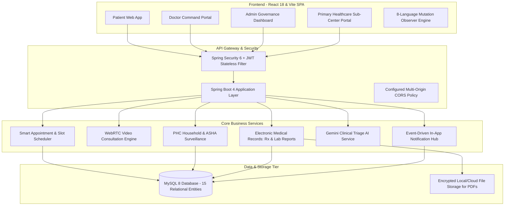

# 🏥 Aayush Smart Healthcare

<p align="center">
  
  
  
  
  
  
  
  
</p>

<p align="center">
  <b>Enterprise-Grade Distributed Healthcare Platform bridging Rural Primary Health Centres (PHCs), Apex Tertiary Hospitals, Certified Specialists, and Patients across India.</b>
</p>

---

## 🌐 Live Deployment

| Service | Status | Link |
| :--- | :--- | :--- |
| **Production Web Platform** | 🚀 *Deployment in Progress* | **[Coming Soon](#)** |
| **Backend REST API & Swagger** | 🔄 *Staging Pipeline Active* | **[Coming Soon](#)** |
| **Source Code Repository** | 🟢 *Active & Maintained* | **[GitHub Repository](https://github.com/Cherukuri-Venkatesh/AAYUSH-SMART-HEALTHCARE)** |

---

## 📑 Table of Contents

- [Key Highlights for Engineering Recruiters](#-key-highlights-for-engineering-recruiters)
- [System Architecture](#-system-architecture)
- [Multi-Tier Role Ecosystem](#-multi-tier-role-ecosystem)
- [Interactive Demo Accounts & Sample Data](#-interactive-demo-accounts--sample-data)
- [Recruiter Walkthrough & Feature Testing Guide](#-recruiter-walkthrough--feature-testing-guide)
- [Enterprise Tech Stack](#-enterprise-tech-stack)
- [Local Development & Setup](#-local-development--setup)
- [Security & Engineering Best Practices](#-security--engineering-best-practices)
- [Author & Professional Connect](#-author--professional-connect)

---

## 💎 Key Highlights for Engineering Recruiters

- **High-Throughput Concurrency with Java 21 Virtual Threads (Project Loom):** Handles thousands of concurrent tele-consultation requests and scheduling transactions with minimal CPU context-switch overhead.
- **Sub-Second Dynamic Slot Allocation Engine:** Guarantees zero double-booking and zero timezone skew across doctors, outpatient departments (OPD), and rural PHC clinics.
- **Peer-to-Peer Telemedicine with WebRTC Signaling:** Real-time encrypted audio-video consultations with active room state persistence, consultation duration tracking, and in-call prescription delivery.
- **Multilingual Healthcare Delivery (8 Indian Languages):** Proprietary mutation-observing DOM localization engine supporting **Telugu, Hindi, Tamil, Kannada, Marathi, Bengali, Gujarati, and English** with zero layout shift.
- **Generative AI Clinical Assistant (Google Gemini 1.5):** Context-aware preliminary triage, multi-turn medical conversational context, and emergency medical recommendation fallback.
- **Production-Hardened Security & RBAC:** Stateless JWT authentication, BCrypt password hashing, Spring Security 6 authorization filters, SQL injection prevention, and zero hardcoded secrets.

---

## 🏛️ System Architecture



---

## 👥 Multi-Tier Role Ecosystem

| Role | Portal Path | Primary Responsibilities |
| :--- | :--- | :--- |
| **🛡️ System Administrator** | `/admin-dashboard` | Hospital network onboarding, doctor credential verification, PHC regional oversight, platform analytics. |
| **🩺 Certified Doctor** | `/doctor-dashboard` | Daily availability & slot upload, appointment queue management, WebRTC telemedicine, digital prescription & lab report issuing. |
| **🧑‍⚕️ Patient** | `/` *(Public / Patient Hub)* | Specialist search by clinical discipline, smart slot booking, encrypted medical history, lab reports, AI symptom triage. |
| **🏥 PHC Health Worker** | `/phc-centers/dashboard` | Grassroots household health surveys, high-risk maternal ANC tracking, infant immunization surveillance, tertiary specialist tele-referrals. |

---

## 🔑 Interactive Demo Accounts & Sample Data

The database comes pre-seeded with a complete set of enterprise healthcare data for instant evaluation.

> [!NOTE]
> All demo accounts share the uniform testing password: **`123456`**

### 1. 🛡️ System Administrator Accounts
| Name | Email | Password | Primary Test Features |
| :--- | :--- | :--- | :--- |
| **Aayush Super Admin** | `aayushhealthcare2026@gmail.com` | `123456` | Full platform dashboard, hospital directory, doctor credentialing, system-wide metrics. |
| **System Admin** | `admin@gmail.com` | `123456` | Backup administration, PHC center monitoring, community health audit logs. |

### 2. 🩺 Certified Specialist Doctor Accounts
| Doctor Name | Specialization & Hospital | Email | Password | Consulting Fee |
| :--- | :--- | :--- | :--- | :--- |
| **Dr. Rajesh Sharma** | General Physician &bull; AIIMS New Delhi | `rajeshsharma@gmail.com` | `123456` | ₹500 |
| **Dr. Ananya Iyer** | Interventional Cardiologist &bull; Apollo Hospitals | `ananyaiyer@gmail.com` | `123456` | ₹800 |
| **Dr. Suresh Varma** | Consultant Dermatologist &bull; Manipal Hospital | `sureshvarma@gmail.com` | `123456` | ₹600 |
| **Dr. Priya Nair** | Senior Obstetrician & Gynecologist &bull; Fortis Memorial | `priyanair@gmail.com` | `123456` | ₹700 |
| **Dr. Arvind Kulkarni** | Chief Neurologist &bull; Govt General Hospital (GGH) | `arvindkulkarni@gmail.com` | `123456` | ₹900 |

### 3. 🧑‍⚕️ Patient Accounts
| Patient Name | Email | Password | City / Location | Existing Records Available |
| :--- | :--- | :--- | :--- | :--- |
| **Venkatesh Cherukuri** | `venkatesh@gmail.com` | `123456` | Vijayawada, AP | Active online consultation, live notifications, lab reports, prescriptions. |
| **Sunita Rao** | `sunita@gmail.com` | `123456` | Hyderabad, TS | Completed cardiac consultation, downloadable lipid profile lab report & Rx. |
| **Mohammad Arshad** | `arshad@gmail.com` | `123456` | Bengaluru, KA | Booked dermatology consultation, history records. |
| **Lakshmi Devi** | `lakshmidevi@gmail.com` | `123456` | Vijayawada, AP | Prenatal obstetric follow-up with active reminder notifications. |
| **Amit Patel** | `amitpatel@gmail.com` | `123456` | New Delhi | Completed neurological review, Brain MRI reports. |

### 4. 🏥 Rural Primary Healthcare Centres (PHCs)
| PHC Name | Location | Email | Password | Field Staff Assigned |
| :--- | :--- | :--- | :--- | :--- |
| **Urban PHC Benz Circle** | Vijayawada Urban, AP | `phcbenzcircle@gmail.com` | `123456` | Padma Vathi (PHC Staff) |
| **Alluri Tribal PHC Rampachodavaram** | Alluri Sitharama Raju Agency, AP | `phcrampa@gmail.com` | `123456` | Kavitha Devi (ASHA Worker) |
| **Model PHC Chandragiri** | Tirupati District, AP | `phcchandragiri@gmail.com` | `123456` | Shantha Kumari (ANM Worker) |
| **PHC Devikapuram** | Tiruvannamalai, Tamil Nadu | `phcdevikapuram@gmail.com` | `123456` | Selvi Murugan (ASHA Worker) |
| **Sub-District PHC Channapatna** | Ramanagara, Karnataka | `phcchannapatna@gmail.com` | `123456` | Girija Gowda (ANM Worker) |

---

## 🧪 Recruiter Walkthrough & Feature Testing Guide

Follow these step-by-step user journeys to experience all features:

```text
  ┌─────────────────┐       ┌─────────────────┐       ┌─────────────────┐
  │  1. Login Admin │  ───> │ 2. Verify Specs │  ───> │ 3. Audit System │
  └─────────────────┘       └─────────────────┘       └─────────────────┘
           │
           ▼
  ┌─────────────────┐       ┌─────────────────┐       ┌─────────────────┐
  │ 4. Login Doctor │  ───> │ 5. Add Schedule │  ───> │ 6. Launch Video │
  └─────────────────┘       └─────────────────┘       └─────────────────┘
           │
           ▼
  ┌─────────────────┐       ┌─────────────────┐       ┌─────────────────┐
  │ 7. Book Patient │  ───> │ 8. Join Room    │  ───> │ 9. View Rx / AI │
  └─────────────────┘       └─────────────────┘       └─────────────────┘
```

### Flow A: Doctor Scheduling & Telemedicine (Tested & Verified)
1. Navigate to `/login` and select **Doctor Login**.
2. Sign in with `rajeshsharma@gmail.com` / `123456`.
3. Open **Doctor Schedule**:
   - Choose a target consultation date, set hours (e.g., 09:00 to 13:00), 30-minute duration, and mode (**Online / Physical / Both**).
   - Save schedule: The slots are instantly computed and published to patients.
4. Open **Doctor Appointments**:
   - Inspect patient appointment queue.
   - Click **Join Video Consultation** for `venkatesh@gmail.com` (Room: `ROOM-AYUSH-10001`).
   - Issue clinical prescriptions and upload patient lab diagnostics in one click.

### Flow B: Patient Appointment Booking & AI Triage (Tested & Verified)
1. Open patient homepage `/` or sign in with `venkatesh@gmail.com` / `123456`.
2. Discover doctors by specialty (**General physician, Cardiologist, Dermatologist, Gynecologist, Neurologist**).
3. Select **Dr. Rajesh Sharma**:
   - Notice that available dates match exactly with the doctor's active schedule.
   - Book an available time slot — slots are dynamically locked and verified.
4. Experience **Gemini Clinical AI Assistant**:
   - Click the AI Chatbot floating icon on the bottom right.
   - Describe symptoms in English, Telugu, Hindi, or any supported regional language.
   - Observe contextual clinical triage, preliminary guidance, and appropriate doctor department referrals.
5. Check **My Prescriptions** & **My Lab Reports** to view generated medical documents.

### Flow C: Administrative Governance & Health Intelligence
1. Navigate to `/login` and sign in as Admin with `aayushhealthcare2026@gmail.com` / `123456`.
2. **Dashboard Overview:** Real-time metrics for total doctors, registered patients, completed appointments, and revenue.
3. **Hospital Management:** Register tertiary apex hospitals and attach specialized medical departments.
4. **Doctor Verification:** Inspect medical registrations and approve/manage doctor profiles.
5. **Community Health Surveillance:** Review district-level morbidity indices submitted by rural PHC workers.

### Flow D: Rural Primary Healthcare Centre (PHC) Grassroots Platform
1. Sign in with `phcrampa@gmail.com` / `123456` at `/login`.
2. Access **PHC Dashboard**:
   - Review household population counts, vulnerable maternal cases, and infant immunization coverage.
   - Log household door-to-door health visit outcomes and high-risk flags.
   - Escalate severe patients via direct referral to connected district tertiary hospitals.

---

## 🛠️ Enterprise Tech Stack

### **Backend Architecture**
- **Core Runtime:** Java 21 (LTS) with Project Loom Virtual Threads
- **Web Framework:** Spring Boot 4.0.2
- **Data Persistence:** Spring Data JPA with Hibernate ORM
- **Database Engine:** MySQL 8.0 with automated constraint enforcement
- **Security:** Spring Security 6, Stateless JWT Token Verification, BCrypt Cryptography
- **Real-Time Communication:** WebSockets & WebRTC Signaling Gateways
- **Artificial Intelligence:** Google Gemini AI Studio API Integration
- **Mail Integration:** Spring Mail with asynchronous JavaMailSender

### **Frontend Architecture**
- **User Interface:** React 18 SPA (Functional Components & Custom Hooks)
- **Tooling & Bundler:** Vite 5 with HMR
- **Routing:** React Router DOM v6 with protected route guards
- **Internationalization:** Custom Mutation-Observing DOM Translator supporting 8 Indian Languages
- **Visual Design:** Modular Vanilla CSS, Bootstrap 5, Glassmorphism UI tokens, and Toast Notification Engine
- **Media Delivery:** SVG iconography and optimized web assets

---

## 💻 Local Development & Setup

### 1. Prerequisites
- **Java Development Kit:** JDK 21+
- **Node.js Environment:** v18+ & npm
- **Relational Database:** MySQL 8.0+

### 2. Clone the Repository
```bash
git clone https://github.com/Cherukuri-Venkatesh/AAYUSH-SMART-HEALTHCARE.git
cd AAYUSH-SMART-HEALTHCARE
```

### 3. Configure Environment Variables
Copy the template configuration file:
```bash
cp .env.example .env
```
Update `.env` with your local database credentials and API keys:
```properties
DB_URL=jdbc:mysql://localhost:3306/healthcare_db?useSSL=false&allowPublicKeyRetrieval=true&serverTimezone=UTC
DB_USERNAME=root
DB_PASSWORD=your_password
MAIL_USERNAME=your_email@gmail.com
MAIL_PASSWORD=your_app_password
JWT_SECRET=your_jwt_secret_key
GEMINI_API_KEY=your_gemini_api_key
```

### 4. Database Setup & Seeding
```bash
# Create database
mysql -u root -p -e "CREATE DATABASE IF NOT EXISTS healthcare_db;"

# Seed production mock data
mysql -u root -p healthcare_db < BACKEND/src/main/resources/seed_mock_data.sql
```

### 5. Launch Backend Service
```bash
cd BACKEND
./mvnw clean spring-boot:run
```
*Backend runs at:* `http://localhost:8080`

### 6. Launch Frontend Client
```bash
cd FRONTEND
npm install
npm run dev
```
*Frontend runs at:* `http://localhost:5173`

---

## 🔒 Security & Engineering Best Practices

- **Zero Hardcoded Credentials:** 100% of sensitive properties (database passwords, mail secrets, JWT tokens, AI keys) are dynamically ingested from `.env` and kept strictly excluded from git tracking.
- **Defensive Database Constraints:** Phone numbers strictly validated to 10 digits, pincodes to 6 digits, and email addresses verified against valid pattern formats.
- **Stateless Session Management:** Zero server-side session memory allocation; all authentication is cryptographically validated per HTTP request.
- **Timezone Resilience:** All schedule calculations and appointment slots are standardized to UTC/ISO-8601 timestamps to prevent cross-timezone date discrepancy bugs.

---

## 👨‍💻 Author & Professional Connect

**Venkatesh Cherukuri**  
*Lead Full-Stack & Systems Software Engineer*

- 🌐 **GitHub:** [@Cherukuri-Venkatesh](https://github.com/Cherukuri-Venkatesh)
- 💼 **LinkedIn:** [Venkatesh Cherukuri](https://linkedin.com/in/)
- 📧 **Direct Contact:** `venkateshcherukuri79@gmail.com`

---

<p align="center">
  <b>Designed and Engineered for High-Availability, Scalable Healthcare Delivery across India.</b>
</p>